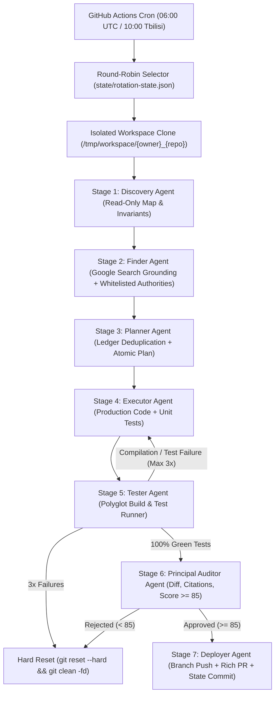

# AutonomousAgentHub — Multi-Repository Autonomous Evolution Hub

**AutonomousAgentHub** is a centralized, zero-cost ($0/month) **Hub-and-Spoke Multi-Repository Autonomous Evolution Engine** engineered in **C# / .NET 8.0**. Running daily on **GitHub Actions (`ubuntu-latest`)**, it uses **Google AI Studio's Free Tier (`GEMINI_API_KEY`)** with **Google Search Grounding** and a **GitHub Personal Access Token (`GH_ORCHESTRATOR_PAT`)** to inspect, research, improve, test, audit, and submit verified Pull Requests across polyglot repositories.

---

## Architecture & 7-Stage Autonomous Pipeline



### Supported Polyglot Stacks (`PolyglotBuildTestRunner`)

| Stack | Manifest Detection | Default Build Command | Default Test Command |
| :--- | :--- | :--- | :--- |
| **.NET / C#** | `*.sln`, `*.slnx`, `*.csproj` | `dotnet restore && dotnet build --no-restore -c Release` | `dotnet test --no-build -c Release` |
| **Java / Maven** | `pom.xml` | `mvn test-compile -B` | `mvn test -B` |
| **Java / Gradle** | `build.gradle`, `build.gradle.kts` | `./gradlew testClasses --no-daemon` | `./gradlew test --no-daemon` |
| **Python** | `pyproject.toml`, `requirements.txt`, `setup.py` | `python3 -m venv .venv && ... && pip install pytest` | `. .venv/bin/activate && pytest` |
| **Node.js / TS** | `package.json` | `(npm ci \|\| npm install) && npm run build --if-present` | `npm test` |

---

## Repository Structure

```text
autonomous-agent-hub/
├── AutonomousAgentHub.sln
├── config/
│   └── repositories.json                      # Allowlist of target repositories + per-repo overrides
├── state/
│   ├── rotation-state.json                    # Tracks last_processed_index, last_run_utc, last_repo
│   └── ledgers/                               # Per-repository memory ledgers (prevents duplicate PRs)
│       └── .gitkeep
├── src/
│   └── AutonomousAgentHub.Core/
│       ├── AutonomousAgentHub.Core.csproj
│       ├── Program.cs                         # CLI Entrypoint (--dry-run, --repo override, normal daily run)
│       ├── Configuration/
│       │   ├── HubConfig.cs
│       │   └── RepositoryEntry.cs
│       ├── Contracts/                         # Strongly-typed JSON schemas for all 7 stages
│       │   ├── Stage1DiscoveryArtifact.cs
│       │   ├── Stage2FinderArtifact.cs
│       │   ├── Stage3PlannerArtifact.cs
│       │   ├── Stage4ExecutionArtifact.cs
│       │   ├── Stage5TestReportArtifact.cs
│       │   ├── Stage6AuditVerdictArtifact.cs
│       │   └── RepoStateLedger.cs
│       ├── Infrastructure/
│       │   ├── GeminiFreeTierClient.cs        # Gemini REST client + Search Grounding + 429 Exponential Backoff
│       │   ├── PolyglotBuildTestRunner.cs     # Auto-detects & runs .NET, Java/Maven/Gradle, Python/pytest, Node/npm
│       │   ├── GitWorkspaceManager.cs         # Clones target repo, creates branches, diffs, reverts, pushes
│       │   ├── GitHubPullRequestClient.cs     # Opens rich Pull Requests via GitHub REST API
│       │   └── StateLedgerManager.cs          # Reads/writes rotation-state.json and state/ledgers/{owner}__{repo}.json
│       └── Pipeline/
│           ├── SevenStageOrchestrator.cs      # Master state machine coordinating Stages 1 through 7
│           ├── Stage1DiscoveryAgent.cs        # Read-only repo & domain analyzer
│           ├── Stage2FinderAgent.cs           # Official documentation & authoritative standard researcher
│           ├── Stage3PlannerAgent.cs          # Safe architecture/logic/bug improvement planner
│           ├── Stage4ExecutorAgent.cs         # Code & test writer / modifier
│           ├── Stage5TesterAgent.cs           # Build + new & regression test runner with 3x self-healing loop
│           ├── Stage6AuditorAgent.cs          # Independent critic validating diff, tests, invariants, and citations
│           └── Stage7DeployerAgent.cs         # Branch pusher, PR creator, and central state updater
├── tests/
│   └── AutonomousAgentHub.Tests/
│       ├── AutonomousAgentHub.Tests.csproj
│       ├── RotationLogicTests.cs
│       ├── PolyglotDetectorTests.cs
│       └── PipelineContractSerializationTests.cs
├── .github/
│   └── workflows/
│       └── daily-autonomous-orchestrator.yml  # Daily cron + manual dispatch with .NET, Java, Python, Node pre-installed
└── README.md
```

---

## Zero-Cost ($0) Setup Guide

### 1. Configure GitHub Actions Secrets
In your `autonomous-agent-hub` GitHub repository settings, navigate to **Settings -> Secrets and variables -> Actions** and add two Repository Secrets:

1. **`GEMINI_API_KEY`**: Obtain a free API key from [Google AI Studio](https://aistudio.google.com/).
2. **`GH_ORCHESTRATOR_PAT`**: Create a Fine-Grained GitHub Personal Access Token (PAT) scoped to your target repositories with:
   - `Contents: Read and write`
   - `Pull requests: Read and write`
   - `Metadata: Read-only`

### 2. Configure Target Repositories (`config/repositories.json`)
Add your target repositories to `config/repositories.json`. Each entry supports optional custom build/test overrides and domain-specific whitelisted authorities (e.g., Microsoft Learn, Spring Docs, OWASP, IETF RFCs, WHO/AAP/NICE/CDC, PCI-DSS/ISO-20022).

### 3. Local Build, Test & Dry-Run Verification

```bash
# Restore and build solution
dotnet restore AutonomousAgentHub.sln
dotnet build AutonomousAgentHub.sln --configuration Release

# Run full unit test suite
dotnet test AutonomousAgentHub.sln --configuration Release

# Run CLI in read-only Dry-Run verification mode
dotnet run --project src/AutonomousAgentHub.Core -- --dry-run

# Target a specific repository override in Dry-Run mode
dotnet run --project src/AutonomousAgentHub.Core -- --dry-run --repo TatoTopuria/python-clinical-analytics-api
```

